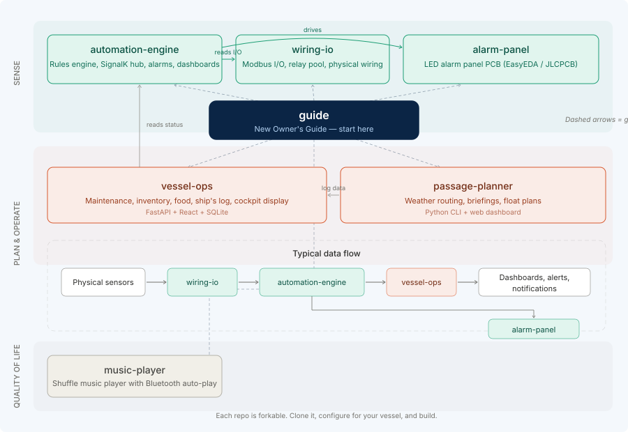

<!--
Purpose: Wiki index for the New Owner's Guide — page list, reading order, status.
Version: v1 (2026-11-04)
Scope: PUBLIC — wiki entry point.
Architecture: Each page maps to one step of the 8-step AI workflow.
Invocation: n/a (reference doc)
-->

# New Owner's Guide — Wiki

Page index for the guide. Each page maps to one step of the AI workflow that a new
owner's AI session follows. Pages marked **STUB** have scope and acceptance criteria
but not yet the full content.

## System overview

## Pages (reading order = build order)

| # | Page | Workflow Step | Status |
|---|---|---|---|
| 0 | [Decision Tree](00-Decision-Tree.md) | Requirements session | **DRAFT** |
| 1 | [Boat Survey Template](01-Boat-Survey-Template.md) | Boat survey | **DRAFT** |
| 2 | [Architecture Tiers](02-Architecture-Tiers.md) | Architecture design | **DRAFT** |
| 3 | [Gap Analysis Template](03-Gap-Analysis-Template.md) | Gap analysis | **DRAFT** |
| 4 | [Reference BOM](04-Reference-BOM.md) | BOM generation | **DRAFT** |
| 5 | [Before You Build](05-Before-You-Build.md) | Build plan — marine electrical | **DRAFT** |
| 6 | [Rules Authoring Tutorial](06-Rules-Authoring-Tutorial.md) | Rules customization | **DRAFT** |
| 7 | [Commissioning Guide](07-Commissioning-Guide.md) | Commission and test | **DRAFT** |
| — | [Glossary and Concepts](Glossary.md) | Reference — terminology and key concepts | **DRAFT** |
| — | [Generic vs Lee-Specific](Generic-vs-Lee-Specific.md) | Cross-cutting | **DRAFT** |

## Catalogue

Product guides — what to buy, what it gives you, and how it connects.

| Page | Covers | Status |
|---|---|---|
| [Waveshare Buyer's Guide](Waveshare-Buyers-Guide.md) | I/O modules — Modbus relay, DI, AI, and combo modules | **DRAFT** |
| [Sensor Buyer's Guide](Sensor-Buyers-Guide.md) | Sensors — bilge, fire, engine, temperature, current, tank, security | **DRAFT** |

## What "DRAFT" and "STUB" mean

- **DRAFT**: content written, covers the topic, may need refinement or Lee's review.
- **STUB**: scope and acceptance criteria defined, content not yet written. An AI session
  can still use the stub to understand what the page WILL cover, and can improvise in the
  meantime using the reference repos.

## How pages reference the source repos

Each page says which files in the reference repos it draws from and which parts are
generic (transferable to any boat) vs. Lee-specific (configuration for SV Unladen Swallow 2).
When a page says "see automation-engine spec/04-Interfaces/rules-schema.md", the AI
session should read that file — it is the authoritative reference; this guide teaches
how to USE it, not replaces it.
